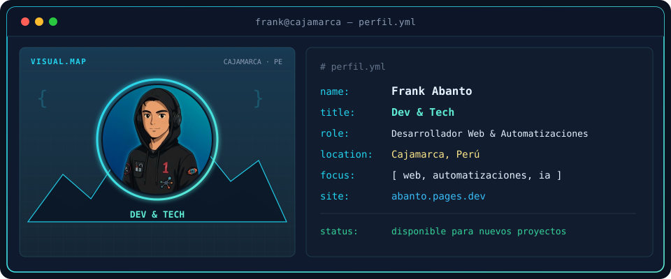
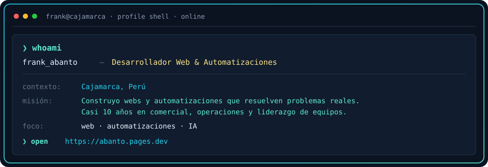
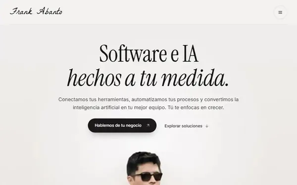
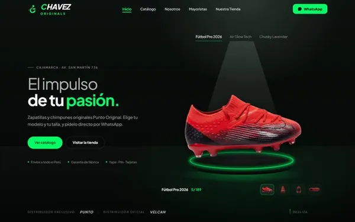
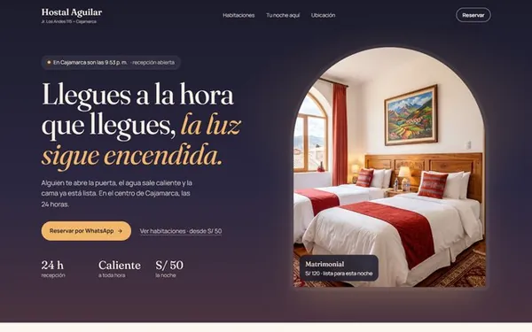
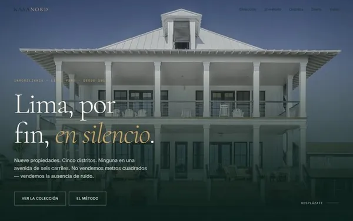
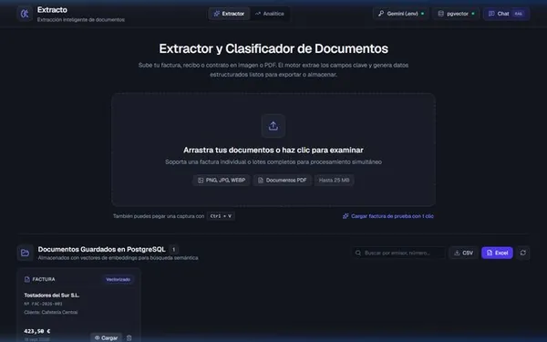

<!--
README de perfil de Frank Abanto (FrankUsqAbant).
Sitio canónico: https://abanto.pages.dev
No usar el dominio abanto.dev (no es propio).
-->

<a href="https://abanto.pages.dev">
  <picture>
    <source media="(prefers-color-scheme: dark)" srcset="assets/banner-dark.svg">
    <source media="(prefers-color-scheme: light)" srcset="assets/banner-light.svg">
    
  </picture>
</a>

 

 

---

## `$ whoami`

  <picture>
    <source media="(prefers-color-scheme: dark)" srcset="assets/whoami-dark.svg">
    <source media="(prefers-color-scheme: light)" srcset="assets/whoami-light.svg">
    
  </picture>

---

## `$ ls proyectos/`

Una selección de <strong>proyectos demo</strong> de web y herramientas para negocios: catálogos, reservas y pedidos. También desarrollo proyectos personales como Prospect Tracker / CRM, Life OS y un VPS con n8n y un bot de Telegram (API Gemini).

<!-- Para que un repo nuevo salga aquí: agrégale el topic `portfolio` (o `featured`). -->
<!-- PROJECTS:START -->
<table>
<tr>
<td width="33%" align="center" valign="top">
  
   
  <strong>Portafolio</strong>
   
  Portafolio de Frank Abanto: Software e IA hechos a tu medida.
    
  
  
</td>
<td width="33%" align="center" valign="top">
  
   
  <strong>Chavez Originals</strong>
   
  Chavez Originals (Cajamarca): tienda de calzado con vitrina interactiva, catálogo administrable con Supabase y pedidos por WhatsApp · Proyecto demo
    
  
  
</td>
<td width="33%" align="center" valign="top">
  
   
  <strong>JIRÉH Pastelería</strong>
   
  JIRÉH Panadería y Pastelería (Cajamarca): catálogo de tortas, &#x27;Arma tu torta&#x27; en vivo y pedidos por WhatsApp · Proyecto demo
    
  
  
</td>
</tr>
<tr>
<td width="33%" align="center" valign="top">
  
   
  <strong>Hostal Aguilar</strong>
   
  Hostal Aguilar (Cajamarca): web con concepto &#x27;la luz encendida&#x27;, reservas por WhatsApp y panel con Supabase · Proyecto demo
    
  
  
</td>
<td width="33%" align="center" valign="top">
  
   
  <strong>Kasa Nord</strong>
   
  Kasa Nord — landing de inmobiliaria de lujo en Lima. HTML/CSS/JS planos, sin build · Proyecto demo
    
  
  
</td>
<td width="33%" align="center" valign="top">
  
   
  <strong>Extracto</strong>
   
  App de práctica: extrae y clasifica facturas, recibos y contratos con IA (Gemini) y exporta a Excel.
    
  
  
</td>
</tr>
</table>
<!-- PROJECTS:END -->

---

## `$ cat tech-stack.yaml`

<table border="1" cellpadding="14" bgcolor="#0B1220">
  <thead>
    <tr>
      <th colspan="2" align="left"><code>frank@cajamarca:~$ cat tech-stack.yaml</code></th>
    </tr>
  </thead>
  <tbody>
    <tr>
      <td width="50%" valign="top"><code>├─ lenguajes:</code>  
         
        <code>HTML · CSS · JavaScript · TypeScript · Python</code>
      </td>
      <td width="50%" valign="top"><code>├─ frontend:</code>  
         
        <code>React · Vite · Tailwind CSS · Next.js · Figma</code>
      </td>
    </tr>
    <tr>
      <td valign="top"><code>├─ backend_y_datos:</code>  
         
        <code>Node.js · Supabase · PostgreSQL · Firebase · SQLite</code>
      </td>
      <td valign="top"><code>╰─ cloud_y_herramientas:</code>  
         
        <code>Git · GitHub Actions · Docker · Linux · Cloudflare · Vercel</code>
      </td>
    </tr>
  </tbody>
  <tfoot>
    <tr>
      <td colspan="2">
        <code>ia_y_automatizaciones: n8n · API Gemini&nbsp;&nbsp;·&nbsp;&nbsp;también: Render · CSS Modules</code> 
        <code>status: construyendo webs y automatizaciones</code>
      </td>
    </tr>
  </tfoot>
</table>

---

## `$ connect --redes`

&nbsp;&nbsp;
&nbsp;&nbsp;
&nbsp;&nbsp;
&nbsp;&nbsp;
&nbsp;&nbsp;

 

Hecho con ⚡ desde Cajamarca, Perú · Frank Abanto

